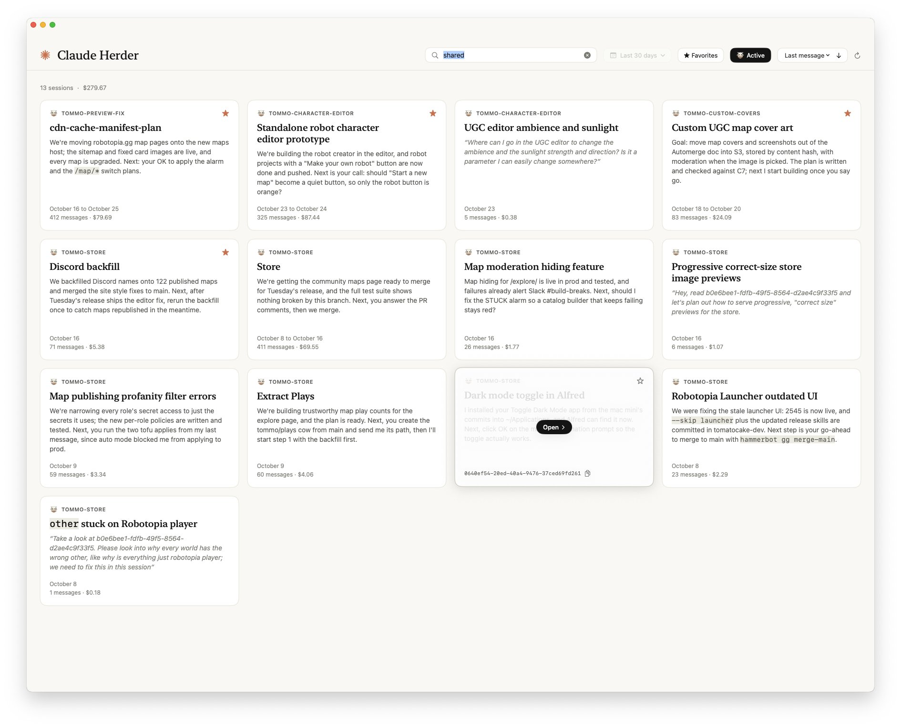

# Claude Code Herder

A Mac app to browse, search and resume your Claude Code sessions, instead of juggling terminal tabs.



Each session is a card with its title, recap, dates, message count and cost.
Click one to resume it in a new [Ghostty](https://ghostty.org) tab.

## Build

Needs macOS 14+, Xcode's Swift toolchain, [ripgrep](https://github.com/BurntSushi/ripgrep) for search, and Ghostty.

```sh
./build_app.sh && open 'Claude Code Herder.app'
```

Cost is estimated from Anthropic's API list prices.

## License

MIT
